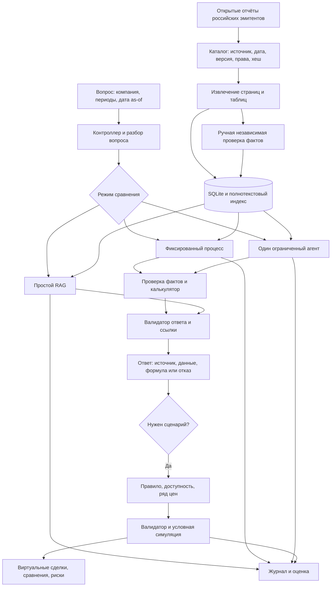

# Агентная архитектура: проект, а не реализация

Дата: 08.11.2026. Вероятно, услышанное «анкетная архитектура» означало «агентная», но точное слово не установлено. Другая возможная трактовка — структура анкеты пользователя для выявления целей и ограничений либо способ собирать экспертную оценку. Таких требований к продукту пока нет. Уточнить преподавателя: «Вы имели в виду агентную архитектуру системы или структуру анкеты? Что именно необходимо показать?»

## Разница подходов

Обычный RAG: найти фрагменты → передать их модели → получить ответ. Он прост, но модель может неверно извлечь число. Фиксированный процесс: программа выполняет определённую последовательность поиска, проверки и вычисления. Агент: модель выбирает из допустимых действий следующее в зависимости от ответа инструмента; программа ограничивает его полномочия и число шагов. [Работа RAG](https://arxiv.org/abs/2005.11401) и [статья ReAct](https://arxiv.org/abs/2210.03629) — архитектурные ориентиры, они не гарантируют качества нашего продукта.

Сравнение: один проход RAG прост и дёшев, но менее контролируем; фиксированный процесс прозрачен и надёжен для известных задач, но плохо адаптируется к неожиданному вопросу; один агент гибче, но требует бюджета и проверки вызовов; несколько агентов дают разделение обязанностей, но добавляют стоимость, задержку и сложность отладки. Для пяти первокурсников с ноутбуком 16 ГБ рекомендуем фиксированный процесс как рабочую основу и одного ограниченного агента как основной исследуемый вариант, сравнивая их на одном корпусе. Мультиагентность вернётся в рассмотрение, только если разметка покажет конкретную пользу и команда сможет её воспроизвести.

## Путь данных

Этап подготовки фактов можно проводить руками; граф не утверждает, что парсер автоматически корректен. Простому RAG оставить его исходный ответ для честного сравнения, при этом аудит доказательств выполняется одинаково для всех; не исправлять ответ A тихой подменой результатов валидатора. В B и C одинаковые программные проверки и калькулятор. Система с mock проверяет интерфейсы, не качество LLM.

## Компоненты и договорённости

| Компонент | Вход и зависимость | Выход и ответственность | Типичные ошибки / действие |
|---|---|---|---|
| Каталог и загрузка | URL, сведения эмитента, условия доступа | `Document`: организация, стандарт, тип, даты, hash, версия, лицензия, доступность | Неизвестна дата или права → пометка и запрет соответствующего сценария/распространения. |
| Парсер и ручная проверка | PDF/HTML, страницы, локальные разрешённые файлы | `Evidence`, кандидаты `Fact`, столбцы и единицы; человек подтверждает | Сканы, сдвинутые столбцы, скобки, вырванный заголовок → ручной ввод и ревью, не автоматическое подтверждение. |
| Хранилище и поиск | документы, фрагменты, метаданные | SQLite, ссылки на PDF, FTS и ранжированные ID | Текстовый поиск пропускает склонения и синонимы: проверить Hit@5/Recall@5; рассмотреть морфологию или гибрид. [FTS5](https://www.sqlite.org/fts5.html) не следует считать готовым русским морфологическим поиском. |
| Разбор и маршрутизация | вопрос, выбранный режим | компания, стандарт, период, as-of, намерение, статус уточнения | Неясная компания/период → запросить уточнение, не угадывать. |
| Контроллер агента | запрос, доступные инструменты, бюджет | выбор следующего вызова или завершения | Ошибочные аргументы, повторные вызовы, превышение лимита → проверка схемы, отказ и трасса. |
| Проверка фактов и калькулятор | fact_id, тип операции | результат Decimal и формула | Валюта, период, организация, знак и версия не совпадают → `conflict` или `missing`; ноль → отказ. |
| Редактор и валидатор ответа | утверждения, evidence_id, расчёт | структурированный ответ, ссылка на нужное место и ограничения | Несуществующий ID блокируется автоматически; семантическое соответствие одного ID недостаточно, нужна выборочная/эталонная ручная проверка. |
| Валидатор сценария и симулятор | подтверждённые факты, дата, правило, цена, расходы | виртуальные события, остатки, метрики, сравнения | Будущий факт, отсутствие цены, неизвестные корпоративные события → отказ или явно обозначенное ограничение. |
| UI и журнал | ответ/сценарий, идентификаторы | понятный экран, запуск и результат | Недоступная модель/ссылка → показать источник проблемы и доступный детерминированный режим; ничего не подменять. |
| Оценка | замороженный набор и логи | таблицы метрик и ошибок | Неполная разметка или нулевые категории → «не измерено», указать n. |

Рекомендуемый стек — Python и `Decimal`, SQLite и FTS, файлы с первичными документами по разрешённым условиям, Streamlit после CLI-проверки. Облачная или локальная модель подменяется через единый интерфейс; требования к памяти, качеству русского и цене проверить на устройстве. FastAPI и фреймворк оркестрации — дополнительные решения при доказанной необходимости, не обязательные для первой демонстрации.

## Инструменты агента

Каждый вход и выход проверяются схемой; агент видит только ограниченные результаты и идентификаторы, не секреты. Ошибка типизирована и возвращает причину; вызовы, время и версии регистрируются.

| Инструмент | Вход → выход | Граница |
|---|---|---|
| `find_documents` | company_id, стандарт, период, as_of → список document_id с датой и версией | Только каталог разрешённого корпуса; не менять источники. |
| `search_evidence` | document_id, запрос, top_k → ранжированные evidence_id и локаторы | Максимум top_k, фильтр версии и даты; найденное ещё не подтверждённый факт. |
| `get_verified_fact` | fact_id, as_of → значение, период, единица, evidence_id | Только подтверждённые факты, доступные на as_of; не создавать значения. |
| `calculate_metric` | operation_id и fact_id → результат, шаги, unit, warnings | Только белый список формул; никакого `eval`, проверки единиц и допустимости. |
| `validate_scenario` | структурированное правило, fact_id и даты → `valid`/причины | Только заранее поддержанные операции, лимиты, часы и данные. |
| `run_simulation` | проверенный сценарий и id разрешённого или искусственного ряда → виртуальные события | Никаких брокерских API и реальных ордеров; остановка при неизвестной дате/цене. |

Ограничение на число вызовов/время и стоимость устанавливается до эксперимента; например, 6 вызовов инструментов — первоначальное инженерное предложение, а не измеренный оптимум. При исчерпании вернуть `budget_exceeded` и то, что можно подтвердить, без выдумывания результата. Неподтверждённые фрагменты, включая указания вида «игнорируй правила», являются данными; [OWASP](https://genai.owasp.org/llmrisk/llm01-prompt-injection/) описывает соответствующий риск. Фильтр и системные указания не гарантируют защиту; полномочия кода и тестовые инъекции обязательны.

## Данные и наблюдаемость

`Document`: id, организация/группа, стандарт и вид, period, `published_at`, точность времени и источник даты, `fetched_at`, URL, SHA-256 и версия, права. `Evidence`: document_id+hash, PDF-page и печатная страница, таблица, строка, колонка/заголовок, фрагмент/координаты, статус проверки. `Fact`: metric и исходная строка, Decimal, исходный знак, валюта и масштаб, интервал или дата остатка, evidence_id и версия. `Calculation`: версия формулы, fact_id входов, совместимость, результат, округление и объяснение. `Answer`: статус, атомарные утверждения и evidence_id, fact_id, calculation_id и предупреждения. `Scenario`: правило/версия, as-of, дата сигнала, ценовой snapshot и происхождение, валюта, издержки, календарь и события. Подробности старой схемы согласуются с [предыдущей архитектурой](../Исследование_2026-11-08/03_Архитектура.md).

`Run`: идентификатор вопроса/набора, версия кода и документа, индекс/настройки поиска и список top-k, модель/промпт/настройки, события вызовов с аргументами и статусом, id использованных фактов и источников, расчёты, версии сценария и входных цен, начало/окончание, токены и тариф, финальный вывод и ошибки. ID и релевантность источника проверяются отдельно. Эти поля дают числители и знаменатели в [спецификации метрик](02_Метрики.md). Не записывать ключи, приватные документы и скрытые данные без разрешения; фиксировать только допустимые метаданные.

## Пример прохождения и отказа

**Полностью вымышленные данные.** «Как изменилась выручка группы Пример за 2025 по сравнению с 2024?» Пользователь выбирает группу, МСФО и as-of после даты публикации. Поиск находит страницу условного отчёта D1; факт F1=120 млн руб. за 2025 и F2=100 млн руб. за 2024 заранее независимо подтверждены. Агент выбирает `get_verified_fact(F1,F2)`, получает оба со ссылками E1/E2 и вызывает `calculate_metric(growth,F1,F2)`. Код проверяет организацию, годовые интервалы, единицы, версии и делитель, возвращает 20%. Ответ: «Выручка выросла со 100 до 120 млн руб., или на 20%», с E1/E2 и формулой. Журнал сохраняет порядок шагов и результат. Если пользователь затем задал сценарий, допустимость даты публикации и ряда цен проверяется отдельно.

**Отказ:** в том же вымышленном запросе на 2025 есть только неподтверждённая ячейка либо документ опубликован после as-of. Ответ: «Не могу рассчитать изменение: подтверждённое значение за 2025 отсутствует в доступных на выбранную дату документах», статус `missing`, ссылка на доступные проверенные документы и указание, чего не хватает. Модель не дорисовывает число. При двух противоречивых допустимых источниках — `conflict`, оба источника и причина; при недоступности модели — технический статус, не финансовый вывод.

Пошаговое назначение участников, результаты и критерии готовности приведены в [плане](04_План.md).
