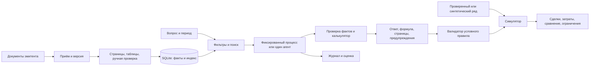

# Архитектура и контракты

08.11.2026. Ниже предложение, код отсутствует. Базовый принцип: факты ссылаются на конкретные версии, модель не является источником чисел.

Пользователь выбирает компанию, стандарт, отчёт и периоды, задаёт вопрос. Фильтры отбирают документы; поиск выдаёт страницы и таблицы вместе с контекстом. Извлечение создаёт кандидатов; неподтверждённые кандидаты не становятся проверенными фактами автоматически. Валидатор сопоставляет организацию/группу, стандарт, период, масштаб, единицу и версию. Код выполняет только допустимую формулу. Ответ ссылается на оба факта и страницы; при отсутствии информации — `missing`, при конфликте — `conflict`, при неверном типе задачи — `unsupported`. Не генерировать число из памяти модели.

## Минимум / предпочтительно / развитие

1. Минимум: вручную подтверждённые значения в разрешённом учебном корпусе; текстовый поиск, одна формула, один вопрос, ссылка на страницу; синтетический сценарий и ручные тесты. Режим mock не демонстрирует качества LLM.
2. Предпочтительно: ограниченный агент на одной доступной модели и фиксированный контрольный процесс с теми же фактами, калькулятором и бюджетом; проверка структуры JSON, интерфейс Streamlit, журнал и воспроизводимая оценка. Оба варианта работают поверх одного корпуса, версий и инструментов.
3. Позже: OCR с проверкой, гибридный поиск по результатам эксперимента, больше отчётов, разрешённые рыночные данные, контроль доступа и интеграции. Переход к ним не требуется для исходного учебного результата.

## Предложенные записи

* `Document`: id, компания/ИНН и группа, тип/стандарт, период, `published_at` и точность (`timestamp`, `date`, `unknown`), ссылка на доказательство публикации, `fetched_at`, URL, hash, версия, правила хранения, статус проверки. Дата загрузки не подменяет публикацию.
* `Evidence`: id документа и хеш, номер страницы PDF и печатный номер, название таблицы, строка и заголовок столбца, фрагмент/координаты, ссылка и статус ручной проверки. Якорь страницы зависит от просмотрщика.
* `Fact`: id, `evidence_id`, метрика и исходное имя, значение Decimal, исходный знак, масштаб и валюта, начало/конец периода или дата остатка, организация/консолидация/стандарт, версия отчёта, статус подтверждения.
* `Calculation`: формула и версия, id входных фактов, результат Decimal, единица, правило округления, допущения и сообщения проверки. Например, `growth=(current/previous-1)*100`; при нуле или несопоставимости — отказ.
* `Answer`: вопрос, as-of, статус, список утверждений с evidence_id, факты, calculation_id, предупреждения, id запуска. Не считать существование ссылки доказательством её смысла.
* `Scenario`: исходные fact_id, правило и его версия, время появления фактов/сигнала, календарь, инструмент и валюта, capital, лимит доли, цены и происхождение, комиссии и проскальзывание, торговые события, цена исполнения, остатки, сравнения и предупреждения.
* `Run`: версии данных/индекса/кода/промпта/модели, настройки, входы, шаги и отказы, длительность, токены/фактические затраты, результат; не хранить секреты.

Схемы — предложенные контракты, их согласуют владельцы до кода. Нельзя исполнять присланный моделью код или следовать командам из отчёта. Whitelist инструментов: `find_documents`, `search_evidence`, `get_verified_fact`, `calculate`, `validate_scenario`, `simulate` с ограничениями шагов и времени. Исходный текст в недоверенном блоке, разрешённые инструменты без брокера и доступа к секретам. При некорректной схеме, несуществующем ID, конфликте версий, несовпадении единиц и отсутствии разрешённой цены — объяснимый отказ.

Симулятор — событийный: проверка даты раскрытия и версии → сигнал → первая допустимая сессия после публикации → проверка цены, объёма и лимита → исполнение с комиссией и проскальзыванием → остаток и стоимость → сравнение с денежной позицией и удержанием при одинаковом окне. События дробления и дивидендов должны быть явно учтены или период запрещён. Результаты на искусственных ценах помечаются искусственными. Сравнение с удержанием учитывает те же доступные цены и комиссии; денежный остаток в рублях по умолчанию не приносит процент, что необходимо отразить.

Рекомендуемая структура после отдельного задания: `docs/` (словарь и решения), `data/manifests` и разрешённые fixtures, `src/{ingest,retrieval,finance,agent,simulation,ui,eval}`, `tests/`, README и lock-файл. Первые контракты — документ, доказательство, факт, расчёт; позднее API и серверы. Пример реального отчёта и ограничения в [исследовании](01_Исследование.md).
