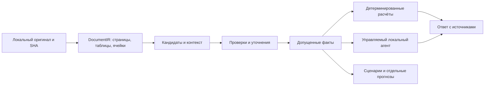

# Актуализация после WIN-01 — 11.11.2026

WIN-01 завершён как feasibility с ограничениями; основной UI для следующего
spike — **WPF + общий Python worker**. Qt source испытан, но повторяются паузы,
а собранный Qt frontend упал при импорте QtCore DLL. [ADR-D01](docs/windows/adr_001_native_ui.md)
содержит практические результаты, измерения и незакрытые accessibility/DPI gates.
Это заменяет предложенный выбор Qt в первоначальном исследовании ниже.
Следующий отдельный этап — [только WIN-02](prompts/windows_02_private_runtime_installer_spike.md),
private runtime/clean-VM installer spike; он ещё не начат. WIN-03–60 не выполнены.
Актуальный статус задач — [roadmap.json](docs/windows/roadmap.json).
Первоначальный план1.0 ниже сохранён побайтово как исходное исследование.

# Локальное Windows-приложение для анализа финансовых документов

Версия плана 1.0, исследование 11.11.2026. Это новый продуктовый трек после КП3-17. По новому решению пользователя академические отчёт/презентация КП3-18 сейчас не выполняются. Код приложения в рамках этого исследования не изменялся. Выбор пользователя: максимально широкий круг финансовых документов; на первом этапе только локальный ИИ, существующий Qwen. Облачная обработка сейчас не нужна.

## 1. Каким должен стать продукт

Устанавливаемое приложение Windows, в котором человек открывает свои документы, видит проверяемые данные, получает анализ и может задать вопрос обычным языком. Для первого запуска не нужны Python, терминал, Git, Docker, отдельный браузер или настройка сервера модели. Приложение не отправляет содержимое документов внешним сервисам. Для строгого локального профиля предлагается несинхронизируемый локальный vault: выбранная пользователем OneDrive/сетевая папка может синхронизироваться сторонней системой, и это показывается отдельно. Для полезной базовой работы ИИ не обязателен; локальный Qwen помогает разбирать задачи, искать сведения и объяснять результаты.

Основной сценарий: **добавить документы → понять состав и качество данных → проверить спорные места → получить анализ → открыть доказательство каждого существенного вывода → исследовать последствия своих предположений**. Чат — один из способов управления этим рабочим пространством.

«Универсальный» означает общую платформу чтения, поиска, проверки и связей между документами с расширяемыми предметными модулями. Это не обещание, что любой неизвестный файл сразу даст правильные финансовые коэффициенты. Для каждого типа документа интерфейс показывает: что распознано, что поддержано методикой, что требует уточнения и что пока недоступно.

У продукта четыре понятных режима: «Разобраться в документе», «Проанализировать компанию или проект», «Сверить документы и платежи», «Построить план или сценарий». Профессиональные поля и технические детали раскрываются по необходимости. Пользователь может начать с одного файла, не создавая сложную модель.

Предполагаемые пользователи: начинающий аналитик, человек со своими выписками, владелец малого бизнеса со счетами и договорами, опытный исследователь отчётности. Это проектные гипотезы; подтверждённых заказчиков, интервью и внедрений пока нет.

## 2. Что уже есть и что переносим

База нового направления — проверенный КП3-17, head `1b9cc821a0ddbfc6054c2622613b2b76df09a2c9`, PR18. Существуют точная арифметика, пять зарегистрированных операций, допуск фактов, обязательный поиск доказательств, ограниченный русский ввод, B/A/C, история/источники и светлый зелёно-белый Streamlit-интерфейс. Последний остаётся образцом поведения и согласованного визуального направления, но новый native UI создаётся отдельно.

D0 получает собственный разрешённый демонстрационный документ и каталог с evidence, чтобы работать офлайн без репозитория и прежней tmp/. Реальные48ячеек доступны для нового запуска только при наличии соответствующих exact-PDF и прохождении прежних gates, а не по одному JSON.

D0 получает собственный разрешённый демонстрационный документ и каталог с evidence, чтобы работать офлайн без репозитория и прежней tmp/. Реальные48ячеек доступны для нового запуска только при наличии соответствующих exact-PDF и прохождении прежних gates, а не по одному JSON.

Сохраняются Catalog/Task/Outcome0.2, Request/Calculation/Outcome0.3, методика и определения04, 48 проверенных ассистентом ячеек восьми exact-PDF-версий, source checks05, признаки целостности06 и точные reference. Все восемь дат публикации неизвестны; human_reviewed=0. Существующая проверка не превращается в автоматическую проверку новых документов.

На17 прошли 799 unit-тестов и 18 Streamlit AppTest. Это исходная регрессия, а не тесты будущего desktop. В контролируемом16 каждый B/A/C прошёл 32 числовых и восемь отказных случаев на известных данных; преимущества модели по точности там не показано. 48 ячеек двух групп не являются достаточной историей для нового прогнозирования. Старый QA07/call_limit и прежние знаменатели сохраняются.

Переиспользуем финансовое ядро, доказательства и контрактные границы. Перерабатываем хранение путей, жизненный цикл заданий, UI, упаковку, универсальный импорт и новые предметные схемы. В коде есть привязки к корню репозитория и `tmp/`, HTTP-viewer/downloads и hardlink-хранилище; простое помещение этого кода в Program Files работать корректно не обязано. Нужен явный `ApplicationPaths/WorkspaceContext` и адаптер старой версии, без ослабления проверок.

## 3. Что даёт обзор рынка

Изучены классы продуктов, а не проведено сравнительное испытание платных систем. Заявления поставщиков о точности не приняты за измерение. Подробная таблица продуктов и первичных источников: [обзор рынка](docs/windows/research_market.md).

| Класс и примеры | Полезный образец для нашего продукта | Ограничение переноса |
|---|---|---|
| AlphaSense, Quartr | Исследование нескольких документов, план поиска, ответ со ссылкой на точный фрагмент | Собственные корпуса/лицензии и облако не становятся нашей локальной базой |
| Daloopa, BamSEC | Исторические таблицы, связь каждой ячейки с документом, сравнение версий, Excel | Нужна собственная разметка и контроль совместимости периодов |
| Fiscal.ai, Koyfin | Три формы, сегменты/KPI, коэффициенты, actual отдельно от estimates | Стандартизованные значения не всегда совпадают с as-reported; FinChat — прежнее имя Fiscal.ai |
| Bloomberg CoFi, FactSet, Capital IQ Pro | Company workspace, peers, point-in-time actual/guidance/consensus | Платные права/данные/доступность не подтверждены и не требуются локальному старту |
| СПАРК, Контур.Фокус, Seldon.Basis | Доступная карточка компании, бухгалтерская отчётность, динамика и сигналы | РСБУ юрлица нельзя выдать за консолидированную IFRS-группу |
| ABBYY, Acrobat | OCR, чтение и сравнение документов, переход к первоисточнику | Лицензия desktop-приложения не равна праву встроить OCR SDK; язык UI не равен языку AI |
| Rossum, DocuWare, Dext | Поля и строки счетов, очередь проверки, связь с оплатой, audit trail | Счёт не доказывает оплату или признанную выручку |
| GnuCash, ПланФакт, Альт-Финансы | Сверка транзакций, план/факт, платёжный календарь, финансовая модель | Учёт, анализ отчётности и прогноз — разные режимы |
| Power Query/Excel, Luminance | Таблицы PDF, воспроизводимые преобразования, договорные обязательства | Извлечение таблицы ещё не проверяет финансовый смысл |

Первоочередная ценность: достоверность и понятная связь с источником, экономия на сверке документов, обзор денежных рисков, повторяемый анализ. Не требуется воспроизводить все функции дорогого терминала.

Официальные примеры: [Daloopa Hub](https://docs.daloopa.com/docs/daloopa-hub-overview), [Quartr AI](https://quartr.com/features/ai-chat), [BamSEC Table Tools](https://www.bamsec.com/features/table-tools), [Fiscal.ai](https://docs.fiscal.ai/docs/introduction), [Dext](https://help.dext.com/en/articles/416727-getting-started-with-dext-for-accountants-and-bookkeepers), [GnuCash](https://www.gnucash.org/features.phtml?lang=en_US). Это ссылки на заявленные функции, не результаты нашего теста.

## 4. Матрица документов и выпусков

| Модуль | Входы | Результат | Главные проверки | Приоритет |
|---|---|---|---|---|
| Общее рабочее пространство | PDF, изображения, CSV/XLSX, DOCX/TXT, безопасный HTML | Поиск, таблицы, краткий обзор, версии, заметки, источники | Тип/размер/целостность/страницы, ограничения извлечения, безопасность | D1 |
| Корпоративная IFRS-отчётность | Три формы, примечания, аудиторское заключение | Динамика, прибыль/денежный поток, долг, сегменты, качество данных | Группа/стандарт/состав строки/период/знак/валюта/версия | D2 |
| РСБУ | Формы и пояснения соответствующей редакции | Баланс, финансовый результат, движение денег, коэффициенты юрлица | Отдельный словарь и действующая редакция форм; не IFRS | D2 |
| Выписки | Сначала CSV/XLSX, затем PDF/сканы | Приход/расход, категории, остатки, дубликаты, сверка | Счёт/валюта/дата проводки и операции, внутренние переводы, opening+flow=closing | D1–D2 |
| Счета, чеки, акты | PDF/изображения/XLSX | Контрагент, позиции, налог, сроки, частичная оплата, недостающие документы | Net/tax/gross, номер/дата/стороны, duplicate, связь с платежом | D2 |
| Договоры, кредиты, аренда | DOCX/PDF и изменения | Обязательства, даты, ставки, индексация, ковенанты, график | Действующая версия/приложения/условия/оговорки; вывод не заменяет юридическую экспертизу | D2–D3 |
| Управленческие документы | Бюджет, план продаж, статьи, проектные таблицы | Пользовательская схема, план/факт, бюджет денег | Mapping явно подтверждён; план отдельно от факта | D2–D4 |
| XBRL/iXBRL/XML | Файлы пользователя, позже разрешённые коннекторы | Структурированные факты и ссылки на контекст | Taxonomy, custom tags, units, duration/instant, исправления | После D1, по спросу |
| Банки/страхование/налоги/эмиссионные документы | Специальные формы | Отдельные предметные модули | Собственные определения и нормативные проверки | После основных модулей |

Сначала русский и английский в заявленных форматах; другие языки — только после проверки соответствующих движков и набора задач. «Файл открывается» не равно «все его показатели поддержаны». Даже неподдержанный финансовый модуль может допускать чтение и поиск с честным статусом.

Зашифрованный файл запрашивает пароль локально, пароль не уходит в лог. Повреждённый/неполный/слишком большой файл получает техническую диагностику. Архивы — только с лимитами распаковки и защитой путей. Макросы, DDE, внешние ссылки, PDF JavaScript и встроенные программы не исполняются. Формулы таблиц не вычисляются произвольным Excel/скриптом: безопасный ограниченный движок либо сохранённое значение с явным статусом свежести.

## 5. Анализ, который нужен сверх разницы прибыли

### 5.1. Полная картина компании

Первый аналитический экран объединяет три формы: баланс, финансовый результат и денежный поток. Полный IFRS-pack дополнительно связывает отчёт об изменениях капитала, прочий совокупный доход и соответствующие примечания. Вертикальный анализ долей, горизонтальные изменения, сопоставимые тренды, исходные валюты и масштабы. Связи: движение капитала, долга, денег, прибыль↔CFO. Несходящийся bridge не «достраивается» моделью: видна непокрытая разница.

Прибыльность: валовая/операционная/чистая маржа, ROA/ROE/ROIC при определённых числителе, знаменателе и среднем капитале. EBITDA/adjusted EBITDA — только при собственной версии определения и источнике корректировок, не переименование OP. Убыточная компания может иметь полезный анализ без бессмысленного относительного роста от отрицательной базы.

Оборотный капитал: дебиторская задолженность, запасы, кредиторская задолженность, DSO/DIO/DPO/денежный цикл при доступных средних остатках и подходящем потоке. Не подставлять выручку вместо закупок автоматически. Количество дней и годовой пересчёт — явная методика, а не скрытый default.

Качество прибыли: расхождение прибыли и денег, разовые статьи, non-cash effects, оборотный капитал, капитализация затрат и изменения оценок при доказательстве в примечаниях. CFO и FCF разделены; capex cash и начисленные приобретения — разные величины. Флаги сигнализируют о вопросе для проверки, а не объявляют мошенничество.

Долг и устойчивость: структура, валюты, fixed/floating rates, сроки, залог, ковенанты, доступная ликвидность, покрытие процентов и сценарный запас до нарушения. Net debt требует политики по аренде/restricted cash и источников. Денежный runway — условный расчёт, не обещание даты банкротства.

Сегменты/география/клиенты: концентрация и вклад в изменение, если раскрыты сопоставимые данные; внутригрупповые исключения не теряются. Примечания: связанные стороны, обязательства, гарантии, судебные вопросы, события после даты, политика/пересмотры и оговорки аудитора. Отсутствие найденного prepared Fact не доказывает отсутствия раскрытия в документе.

### 5.2. Документы бизнеса и личные финансы

Сверка «договор → счёт → акт → платёж»: полное/частичное исполнение, несколько платежей на один счёт, один платёж на несколько счетов, возвраты, скидки, комиссии и валюты. Неоднозначные связи предлагаются человеку, а не фиксируются молча. Внутренний перевод между своими счетами не становится новым доходом.

Категоризация трат/доходов объясняется и исправляется; правила локальны и версионируются. Регулярные платежи и аномалии показываются с основанием. Уведомление о необычной сумме не означает доказанный fraud. Нужны денежный календарь, задолженность по документам, просрочки, будущие известные обязательства и план/факт по проекту/статье.

### 5.3. Объяснения и сравнения

Любое существенное утверждение относится к типу: «написано в источнике», «рассчитано», «интерпретация», «сценарий», «прогноз». Причина из комментария менеджмента цитируется как его объяснение. Арифметический вклад статьи не выдаётся за причинность. Когда вопрос «почему» не закрыт, ответ содержит оставшиеся вопросы.

Сравнение original/comparative, двух редакций договора, отчётов разных лет и компаний требует явной совместимости. Поздняя comparative-ячейка не заменяет исходную. Разные стандарты/периметры/учётные политики показываются. Instant и duration, full_year/YTD/quarter/custom не взаимозаменяемы. Квартал не выводится из разности несопоставимых YTD/разных exact-версий; будущее производное преобразование требует отдельной зарегистрированной методики и доказанной совместимости. IFRS18 обязателен для годовых периодов, начинающихся с01.01.2027, с возможностью раннего применения; дата документа сама не доказывает основу нового operating subtotal. [IFRS18](https://www.ifrs.org/issued-standards/list-of-standards/ifrs-18-presentation-and-disclosure-in-financial-statements/), [IAS34](https://www.ifrs.org/issued-standards/list-of-standards/ias-34-interim-financial-reporting/).

Первые пять операций остаются неизменными. Новые коэффициенты добавляются небольшими методическими пакетами: формула/область/варианты/допуски/границы/независимый reference. Цель первого расширения — полезный согласованный набор, а не количество коэффициентов. Общего «здорового порога» для всех отраслей не назначать.

## 6. Данные, извлечение и доказательства

Оригиналы неизменяемы и имеют SHA/размер/версии; можно выбрать хранение копии в vault или отслеживаемую внешнюю ссылку с проверкой перед использованием. Ни кэш, ни OCR-текст не заменяют оригинал. `DocumentIR` хранит страницы, блоки/координаты, ячейки/строки/колонки, составные заголовки, единицы, печатную нумерацию, таблицы через страницы, лист/ячейку XLSX, абзац/таблицу DOCX. Нужны crop/rotation/zoom transforms для точного highlight.

Независимые состояния: file integrity, extraction, structure, semantic preparation, provenance/admission. OCR confidence — технический признак, не вероятность правильного финансового смысла. У каждого Fact — source cell/строка+колонка, оригинальная запись/знак, период, организация/периметр/стандарт, definition, единицы, версия, способ проверки. DerivedValue хранит граф входов и точную арифметику отдельно.

В новой admission-policy можно разрешить машинно проверенный профиль только в ограниченной области document pack после проверки смыслового соответствия версионированному определению: организация/периметр/стандарт, строка, полный период, знак, единицы и версия. Геометрия, сходящийся баланс, совпадение двух OCR и высокая confidence сами по себе не доказывают смысл. Нужны отдельные измерения false admission/abstention на независимом наборе; policy версионируется и не ослабляет старые gates07. Такой статус называется отдельно и не маскируется под `assistant_checked`/`human_reviewed`. Неизвестный профиль или конфликт требует очереди проверки. Пользователь исправляет конкретное поле/связь; это не подтверждает весь документ. Подтверждённый шаблон применяется только с новой версией/областью и регрессией.

Базовый движок digital PDF — прежний pdfplumber. На собственном разнообразном наборе сравнить Docling, PaddleOCR/PP-Structure, Tesseract и базу; победителя выбрать по точным ячейкам/заголовкам/контексту, RAM/latency и Windows packaging. Не объединять все OCR-библиотеки в обязательный installer. У Docling заявлены локальная работа и OCR; это кандидат, не доказанный лучший движок для российских документов. [Docling](https://github.com/docling-project/docling), [PaddleOCR](https://github.com/PaddlePaddle/PaddleOCR), [pdfplumber](https://github.com/jsvine/pdfplumber).

Важные обнаруженные ограничения: актуальный Surya разделяет Apache2-код и условия весов; его текущий table output не эквивалентен старой геометрической структуре. Table Transformer архивирован, поэтому не выбирается как активно поддерживаемая основа без отдельного решения. Эти проверки версий и лицензий обязательны для любого кандидата. [Surya](https://github.com/datalab-to/surya), [Table Transformer](https://github.com/microsoft/table-transformer).

Поиск начинается со структурированных фильтров и SQLite FTS5: документ/версия/организация/тип/период/definition, затем текст и таблицы. Local embeddings/reranker добавляются только если измерено улучшение на нужных вопросах. Финансовый поиск обязан вернуть полный совместимый комплект точных evidence; сбой поиска не разрешает ответить известным числом из памяти. Для narrative retrieval недостаточно ранжировать похожие фрагменты без покрытия требуемых утверждений.

Основные сущности новой версии: Workspace, Asset/DocumentVersion, DocumentIR/Table/Cell, Candidate, Fact, Transaction, Obligation, MetricDefinition, ComparabilityProof, CalculationReceipt, Claim, AnalysisRun, JobEvent, Scenario и ForecastVintage. Схемы версионированы, миграции обратимы через backup. Старые0.2/0.3 сохраняются через адаптер; проценты в денежные поля не записываются.

## 7. Windows-архитектура: предварительный выбор

**Основной кандидат — PySide6 + Qt Widgets, Python application core, отдельные процессы документов и локальной модели.** Для пользователя это настоящее приложение со своим окном, меню, диалогами файлов и доступностью Windows. UI не обслуживается localhost-сайтом. Это инженерная рекомендация для нынешней Python-базы, окончательно проверяемая WIN-01/02.

**Сильная альтернатива — WPF/.NET + Python worker через ограниченный IPC.** Она особенно уместна, если Qt не пройдёт испытание доступности/PDF/упаковки или не подойдут лицензионные условия. Цена — два основных языка и две сборочные цепочки. Не реализуем два полноценных продукта параллельно.

WinUI3, Tauri, Electron и pywebview рассмотрены в [архитектурном исследовании](docs/windows/research_architecture.md). Tauri/Electron могут быть настоящими desktop-приложениями без UI-сервера, но добавляют web-стек и в данном проекте не дают очевидного преимущества перед native Python UI. Универсального «лучшего фреймворка» нет. [Qt for Python](https://doc.qt.io/qtforpython-6/), [WPF](https://learn.microsoft.com/en-us/dotnet/desktop/wpf/overview).

| Слой | Рекомендация | Проверяемая граница |
|---|---|---|
| Native UI | Qt Widgets, стандартные widgets/table models; утверждённые светлые панели/зелёный акцент | UI не считает формулы и не запускает тяжёлый parsing |
| ApplicationService | Типизированные команды/ответы, version/run_id/workspace/context | Один путь для UI/CLI/agent; нет hidden default/cached answer |
| Domain | Старый admission/calculator + новые изолированные модули | Qwen не подменяет Fact и арифметику |
| Job supervisor | Очередь, прогресс, cancel/deadline/retry, subprocess lifecycle | Закрытие окна не оставляет workers; late result не текущий |
| Хранение | SQLite metadata/FTS5, приватный vault, cache, журналы событий | Install readonly; user-data отдельно; atomic migrations/backup |
| Документы | Сменные import/extraction/OCR/render adapters | Ограничения ресурсов, parsing failure отдельно от отсутствия факта |
| AI | LocalOnlyPolicy, Qwen adapter, версионированные model packs | Никакой автоматической облачной подстановки |
| Установка | Private CPython, onedir + per-user installer; MSIX после проверки | На чистой Windows без Python/терминала/прав администратора |

`ApplicationPaths` разделяет read-only install assets, `%LOCALAPPDATA%` для настроек/кэша/логов/моделей и выбранный пользователем vault документов. Никаких путей `C:\Users\Value`, зависимости от OneDrive, MSYS2 или корня Git. Текущий основной MSYS2 Python не меняется; частный stock CPython и совместимость ядра проверяются отдельно. Старый PDF-worker3.12 можно временно сохранить как private worker, если это подтверждено сборкой.

На старте допустим управляемый Ollama с loopback API только для inference: отсутствие UI-веб-сервера не означает отсутствие любых локальных TCP-соединений. Пользователь не должен устанавливать/настраивать его вручную. Переход к llama.cpp через stdio/named pipe/C API возможен после отдельной проверки parity/качества/производительности; ответы разных runtime не обещаются идентичными. LocalOnly проверяется также при активной сети, вредной конфигурации и чужом Ollama endpoint: loopback/owned process/cloud-disabled policy; нельзя автоматически присоединяться к произвольному уже запущенному серверу. LocalOnly проверяется также при активной сети, вредной конфигурации и чужом Ollama endpoint: loopback/owned process/cloud-disabled policy; нельзя автоматически присоединяться к произвольному уже запущенному серверу. Cloud-provider seam допускается в архитектуре, но cloud выключен и не реализуется в первом выпуске. [Ollama FAQ](https://docs.ollama.com/faq), [llama.cpp](https://github.com/ggml-org/llama.cpp).

SQLite достаточно как начальная metadata/FTS-база; DuckDB полезен позже для крупных табличных выборок при измеренной необходимости. Не нужны заранее микросервисы, Kubernetes или обязательная vector DB.

## 8. Как расширять локального агента

Агент получает не shell/Python/SQL общего назначения, а ограниченные инструменты: список документов, описание схемы/качества, поиск evidence, получение допущенных фактов, чтение примечания, сравнение версий, зарегистрированный расчёт, сверка транзакций, календарь обязательств, сценарий и отдельный forecast. Каждый tool имеет версию, JSON schema, пределы входов/выходов, таймаут и правила доступа. Путь/URL из вопроса не становится командой открытия.

Работа: понять цель → при неоднозначности спросить → показать короткий план → выполнить разрешённые чтения/расчёты → проверить покрытие утверждений → собрать ответ → перечислить неисполненные части. Многошаговый агент нужен для исследования связей, а простая формула остаётся быстрым B-путём. Пользователь видит фактический прогресс, может отменить/продолжить после сбоя.

Durable jobs/checkpoints хранят только проверяемое состояние и версии входов. После изменения документа/валюты/периода/каталога ответ помечается устаревшим и пересчитывается; старые факты из чата не становятся текущими. Долгосрочные предпочтения и заметки отделены от финансовых данных. Повторный клик и retry не создают дублированную запись/экспорт.

Первый вариант — расширение имеющегося контроллера. LangGraph/PydanticAI/Haystack/LlamaIndex оцениваются по конкретной необходимости: durability/schema/pipelines, а не включаются все. Любая интеграция явно конфигурируется на local models и embeddings; чужой cloud default запрещён. [Подробный разбор агента, retrieval и защиты](docs/windows/research_agent_retrieval_security.md).

Qwen3:4b остаётся контрольной точкой. Более крупная/мультимодальная модель, embeddings и reranker — необязательные локальные пакеты после измерения качества, лицензии и памяти. Размер GGUF не равен полной RAM/VRAM: нужны KV cache, OCR, изображения и UI. Восемь/16/32GB — лишь гипотезы аппаратных профилей для тестирования, а не заявленные минимальные требования. Базовое чтение/таблицы/точные расчёты работают и без AI.

## 9. Прогнозирование: четыре разных уровня

1. **Календарь известных обязательств.** Сроки оплаты, проценты/погашения, аренда, налоги по предоставленным данным; показать источник и условия. Это не ML.
2. **Условные сценарии.** Пользователь задаёт объёмы/цены/маржу/сроки оплаты/ставки. Код строит взаимосвязанные P&L/баланс/CF, чувствительность и кассовые разрывы. Допущения видны, сохранены и отделены от actual.
3. **Статистические прогнозы.** Только для пригодной истории регулярных данных: например расходы/касса/продажи, при понятных изменениях режима. Начать с naive/seasonal naive, ETS/ARIMA и сравнения простых моделей. Qwen объясняет прогноз, не генерирует будущие суммы свободным текстом.
4. **Foundation time-series models.** Отдельный необязательный исследовательский модуль, если заранее выбранный на dev/validation вариант подтверждает полезность против baseline в зафиксированном финальном сравнении и подходит по лицензии/ресурсам.

Нельзя из восьми разных отчётных PDF/48 ячеек сделать длинный временной ряд повторением comparative. Нужны уникальные периоды, стабильные определения/периметр/частота/валюта, учёт пересмотров и пропусков. Для исторического теста требуется известно, что было доступно на каждую дату. Дата загрузки сегодняшнего файла не доказывает прошлую публикацию. Нынешняя неизвестность публикации остаётся gate; условный прогноз «из этих загруженных сейчас данных» возможен как отдельная постановка, без заявления point-in-time backtest.

Модели/гиперпараметры выбираются на rolling-origin dev/validation. Locked temporal holdout используется для заранее зафиксированного финального сравнения без подбора по его результатам; следующая итерация требует нового резерва либо признания прежнего теста известным. Модели/гиперпараметры выбираются на rolling-origin dev/validation. Locked temporal holdout используется для заранее зафиксированного финального сравнения без подбора по его результатам; следующая итерация требует нового резерва либо признания прежнего теста известным. Оценка: rolling-origin и отдельный финальный временной holdout, обучение и подбор только на прошлом, отсутствие утечки через нормализацию/пересмотры/будущие covariates. Метрики MAE, bias, MASE при определённом знаменателе, покрытие и ширина интервалов по горизонтам; MAPE не использовать без политики нулей/отрицательных значений. Источники будущих регрессоров должны быть действительно известны либо заданы сценарием. Универсального достаточного числа наблюдений для любой модели нет.

Forecast хранится с issued_at/as_of/training_window/model+data hashes/предпосылками/интервалами, никогда как actual Fact. До эксперимента фиксируется версия целевого actual: первоначальная публикация или latest-restated; можно оценивать обе раздельно, но нельзя задним числом менять эталон. As_of/cutoff учитывают точность и зону доказанной доступности. До эксперимента фиксируется версия целевого actual: первоначальная публикация или latest-restated; можно оценивать обе раздельно, но нельзя задним числом менять эталон. As_of/cutoff учитывают точность и зону доказанной доступности. Когда созревает actual, сохраняется отдельная оценка ошибки. В интерфейсе «план», «сценарий», «прогноз», «оценка внешнего автора» различаются. Цена акции/торговая рекомендация не входит в этот roadmap как обещанный результат.

Лицензионный пример: текущий код TimesFM Apache2 не делает веса TimesFM3 разрешёнными для production — официальный репозиторий отдельно ограничивает их non-commercial/non-production; у прежних версий условия другие. Поэтому default — прозрачные статистические baseline, а не скачивание самого нового checkpoint. [TimesFM](https://github.com/google-research/timesfm#license-notice-for-pretrained-weights), [StatsForecast](https://github.com/Nixtla/statsforecast), [проверка временных рядов](https://otexts.com/fpp3/toolbox.html).

## 10. Интерфейс для обычного человека

Навигация: «Обзор», «Документы», «Анализ», «Платежи и обязательства», «Планы и сценарии», «Помощник», «Настройки». Показываются только доступные в текущем выпуске разделы; пустые декоративные кнопки не нужны. Слева проекты/разделы, в центре задача/данные, справа открываемая панель источника. Белые карточки, спокойный фон, зелёное основное действие, ровная типографика и понятная плотность таблиц — развитие выбранного пользователем образца, без копирования чужой банковской функциональности.

Первый запуск: выбрать папку хранения → открыть собственный учебный пример или файл → увидеть «что получится» → при желании установить локальный AI-пакет с показом размера/требований/лицензии. Большая модель не загружается скрыто. Прерывание скачивания поддерживает resume; offline pack можно импортировать с проверкой подписи/хеша. Базовый режим доступен сразу.

Кнопки называются действием: «Добавить документы», «Проверить найденные суммы», «Сравнить периоды», «Показать источник», «Изменить предположения», «Сохранить анализ». Названия B/A/C, IDs, fingerprints и пути скрыты в диагностике. Ошибки объясняют конкретное действие: «Не удалось прочитать страницу7», «Уточните валюту», «Найдены две версии отчёта».

Результат: краткий ответ, основные числа с единицами/периодом, график только если полезен, объяснение, ограничения и переход к каждой исходной строке. Не создавать ложное чувство уверенности единой зелёной галочкой. Статусы «распознано», «проверено правилами», «требует проверки» имеют текст и различимые значки, не только цвет.

Клавиатура, Narrator/UIA, контраст, масштаб125–200%, длинные русские подписи и большие числа включаются с первого native prototype. Для PDF есть доступная текстовая/табличная альтернатива. Не заставлять пользователя подтверждать каждую уверенно проверенную ячейку, но явно показывать места, требующие решения. «Каждый сможет пользоваться» проверяется выполнением задач новичками, а не одним красивым скриншотом.

## 11. Защита, приватность и доставка

Документы и тексты модели недоверенные. Parser/OCR — отдельные процессы, лимиты страниц/пикселей/памяти/CPU/времени/архивов; опасные вложения не исполняются. Model tool calls проходят allowlist/schema/context validation. Prompt injection из PDF не отменяет эти границы. Job Objects управляют ресурсами/жизненным циклом, но сами по себе не являются полным security sandbox; restricted token/AppContainer проверяется отдельно по совместимости. [OWASP](https://genai.owasp.org/llmrisk/llm01-prompt-injection/), [Windows isolation](https://learn.microsoft.com/windows/win32/secauthz/app-isolation-overview).

Нет скрытой отправки текста/логов/телеметрии, автоматического cloud fallback и внешнего кода из model pack. Обновления и явные загрузки моделей используют отдельный сетевой broker с каталогом доверенных assets; offline mode блокирует их. Проверка целостности не заменяет доверие к издателю, поэтому нужен signed manifest и контроль версий.

Шифрование vault/backup проектируется вместе с восстановлением: DPAPI может защитить ключ на Windows, но не является полным шифрованием SQLite и может мешать переносу backup. Нужны проверенный encrypted store или шифрование выбранных объектов, отдельный переносимый backup с recovery secret и тест восстановления. Не придумывать собственную криптографию.

Первая поставка: частный runtime, onedir, per-user installer (кандидат Inno Setup), меню Пуск/удаление, подписанные executable/installer/manifest обновлений. MSIX/Store — следующий канал после проверки worker/GPU/прав/правил. Onefile не самоцель. На чистой Windows пользователь не устанавливает pip/Ollama/Excel и не меняет PATH. [Inno per-user](https://jrsoftware.org/ishelp/topic_admininstallmode.htm), [PyInstaller](https://pyinstaller.org/en/stable/operating-mode.html), [MSIX](https://learn.microsoft.com/en-us/windows/apps/package-and-deploy/packaging/).

Лицензии проверяются по конкретным модулям/весам: Qt/PySide/LGPL obligations, PDF renderer, OCR dependencies, модели и GPU redistributables. Qt PDF документированной6.8ветки имеет LGPLv3/GPLv2/commercial варианты; PyMuPDF/MuPDF — AGPL/commercial. Нельзя считать все Qt-модули одинаковыми. Собственная лицензия проекта пока не выбрана: публичный GitHub сам по себе её не заменяет. Никакие права на распространение прежних PDF не появились. [Qt obligations](https://www.qt.io/development/open-source-lgpl-obligations), [Qt PDF](https://doc.qt.io/qt-6.8/qtpdf-index.html), [PyMuPDF](https://pymupdf.readthedocs.io/en/latest/about.html).

Подпись не гарантирует мгновенное отсутствие SmartScreen-предупреждений. Путь получения подходящего сертификата/подписи и условия для владельца/региона ещё проверяются; отключать Defender/SmartScreen пользователю не предлагается. Обновление: staging→signature/hash→остановка jobs→backup/migration→atomic switch→health check→rollback. До успешного health check новые записи запрещены; возврат версии проверяет восстановление согласованного snapshot БД после миграции, а не только старого executable. До успешного health check новые записи запрещены; возврат версии проверяет восстановление согласованного snapshot БД после миграции, а не только старого executable. Удаление программы отдельно спрашивает о личных данных. [SmartScreen](https://learn.microsoft.com/en-us/windows/apps/package-and-deploy/smartscreen-reputation).

## 12. Проверка качества и критерии выпуска

Измеряются отдельно: открытие файла, OCR, структура таблицы, контекст/значение ячейки, admission, retrieval, арифметика, grounded claims, agent task completion, сценарий/forecast, UX, установка и производительность. Нельзя одним итоговым процентом скрыть восемь неподдержанных ячеек или технические сбои.

Новый набор включает собственные/разрешённые RU/EN документы разных макетов/организаций/банков/версий и реальные трудности: сканы, поворот, несколько валют, промежуточные периоды, отрицательные числа, пропуски, разные версии. Gold задаётся независимо, вне runtime. Разделение по семейству макета/эмитенту и времени; разработчику известные cases не называются unseen. FinanceBench/FinQA/TAT-QA/OmniDocBench — дополнительные открытые ориентиры, не доказательство качества на наших пользователях и не скрытый новый holdout. [FinanceBench](https://arxiv.org/abs/2311.11944), [TAT-QA](https://arxiv.org/abs/2105.07624), [OmniDocBench](https://github.com/opendatalab/OmniDocBench).

Для каждого заявленного типа — успешные и неподдержанные случаи, испорченные файлы/headers/units/periods/SHA, конфликт источников, candidate без evidence, historical unknown, prompt injection, неправильная tool schema, timeout/OOM/cancel/crash. При техническом сбое нет финансового ответа и ложного подтверждения предпосылки. После смены входов run/answer не переиспользуются молча.

Native UI проверяется реальными действиями, UIA/Narrator/keyboard, масштабом и clean VM; старые Streamlit AppTest сохраняются, но не подменяют эту проверку. Clean VM: без Python/модели/admin, Unicode/пробелы в путях, offline, low disk, обновление N→N+1/rollback, backup restore и uninstall без потери данных. Целевые RAM/startup/latency и минимальная Windows-версия устанавливаются после измерений, не заявляются по документации модели. До V1 фиксируются Windows edition/build/architecture/security-support и совместимая Qt/Python/runtime matrix. До V1 фиксируются Windows edition/build/architecture/security-support и совместимая Qt/Python/runtime matrix.

Пользовательская проверка — отдельный будущий пилот, например5–8 добровольцев с разным опытом и сценариями «добавить документ/найти источник/исправить неоднозначность/понять ограничение/построить сценарий». Это ориентир дизайна исследования, не количество интервью уже состоявшихся и не обязательные подписи формальных участников. Замерить task completion, время, ошибки и понимание результата. Публичный выпуск ограничен реально прошедшей матрицей возможностей.

## 13. Последовательность реализации

Полный исполнимый backlog: [61 задача с зависимостями и готовностью](docs/windows/backlog.md), [машиночитаемый roadmap](docs/windows/roadmap.json). Номер — идентификатор, а не требование выполнять все задачи строго подряд. Security/evaluation/доступность начинаются с первой версии, а поздние задачи завершают их hardening. Каждая значимая задача — отдельная ветка/PR/тег по правилам проекта; merge только по поручению.

| Выпуск | Что пользователь реально получит | Главные задачи/условия |
|---|---|---|
| D0: native foundation | Установка и окно Windows; прежние пять операций с источниками; no UI server | WIN-01–10, ранние50/53/54/55; paths/runtime/IPC/упаковка доказаны |
| D1: document workbench | Свои файлы, поиск/таблицы/источники, проверка спорных мест; первые bank CSV | WIN-11–20,23,56; безопасный импорт, собственный DocumentIR/admission |
| D2: financial workspace | IFRS/РСБУ, выписки/счета, три формы, коэффициенты, долг/примечания, дашборд | WIN-21–36; каждый pack выпускается отдельно по своей матрице |
| D3: research assistant | Локальный многошаговый анализ комплекта, проверяемое объяснение, шаблоны/экспорт | WIN-37–42,40; tools ограничены, память/состояние воспроизводимы |
| D4: planning | План/факт, календарь, driver-сценарии и кассовые разрывы | WIN-43–45; actual/assumptions раздельны и балансы сходятся |
| D5: forecasting, optional | Статистический прогноз пригодных рядов с интервалами и backtesting | WIN-46–48; data readiness/temporal holdout и baseline;49 только R&D |
| V1: публичный scoped release | Проверенная поддерживаемая конфигурация, обновления/backup/документация | WIN-50–59; перечислены поддерживаемые packs, ограничения и аппаратные профили |

D5 не обязан блокировать полезный V1: если прогнозирование не проходит gates, выпускается продукт чтения/анализа/сценариев без него. Специальные отрасли и дополнительные языки также подключаются отдельными версиями. Не откладывать всё приложение до реализации всей карты.

Первые шаги: одинаковый короткий Qt/WPF spike → clean-VM packaging → решение ADR → перенос путей/typed service/jobs → D0. До выбора UI не тратить месяцы на полноценные две реализации. Если минимальный Qt slice проходит доступность/таблицы/PDF/упаковку, продолжать его, сохраняя Python core.

## 14. Сроки, расходы и существенные неизвестности

Календарный срок зависит от доступного времени одного пользователя с Codex, лицензий, hardware и разнообразия данных. Предварительные инженерные диапазоны при регулярной работе: исследовательские spikes1–2недели, D0 ещё3–6недель, D1 ещё4–8, первые packs D2 ещё6–12, зрелый агент/планирование ещё6–12, качественная доставка/пилот ещё4–8 с перекрытием работ. Это не обещание и не сумма независимых сроков; после WIN-01–03 план переоценивается по фактическим блокерам. Эти диапазоны — иллюстративный бюджет волн, не оценка вероятной даты: недельная загрузка неизвестна. Вся карта шире V1 и не имеет подтверждённого общего календаря; после spikes нужно выбрать scope первого выпуска. Полная универсальность — продолжаемое развитие адаптеров, а не одна упаковка `.exe`.

Старт не требует платных financial terminals и облачного AI. Возможные расходы: подпись/издатель, тестовые Windows VM/оборудование, лицензия коммерческого renderer/OCR при выборе, разрешённые данные, поддержка/сайт загрузки. Цены и возможность оплаты в конкретном регионе сейчас не подтверждены. Покупки/лицензионные обязательства/конечная лицензия проекта требуют отдельного содержательного решения пользователя; исследование их не оформляет.

Главные риски и ответы: плохие сканы→проверка/честный unsupported; разный смысл строк→definition/admission; слабая локальная модель→короткие tools/B fallback только явно разрешённый и обозначенный; нехватка RAM→очередь/профили/CPU basic; изменённый источник→invalidation; упаковка/native UI→ранний clean-VM spike; лицензии→versioned inventory; слишком широкий scope→последовательные полезные выпуски; прогнозная утечка→vintages/temporal holdout; незнакомые пользователи→реальный пилот вместо уверенности автора.

## 15. Решения, которые можно принять сейчас

Принять направление local-first/native и универсальную платформу с явными packs; переиспользовать доказательное финансовое ядро; сделать Qt основным кандидатом и WPF проверяемой альтернативой; сохранить Qwen на старте и отделить прогнозы от LLM; выпускать D0/D1 раньше всех сложных функций. Эти решения обратимы и следуют текущему запросу.

Окончательный framework/runtime/PDF/OCR/weights, минимальное hardware, лицензия проекта и публичный signing channel пока не считаются подтверждёнными. Их закрывают конкретные задачи, а не ожидание формальной командной приёмки. Облако, торговля, массовый scraping и автоматическое изменение исходных документов не включаются по умолчанию.

Самостоятельный следующий промт: [только WIN-01 — проверка native архитектуры](prompts/windows_01_native_desktop_spike.md). На этом исследовательском этапе промт подготовлен, но не применяется: пользователь запросил исследование и план, а не начало реализации.

Материалы исследования: [рынок](docs/windows/research_market.md), [Windows](docs/windows/research_architecture.md), [финансовая методика/OCR/прогнозы](docs/windows/research_finance.md), [агент/retrieval/security](docs/windows/research_agent_retrieval_security.md), [реестр источников](docs/windows/sources.json), [проверки исследования](evaluation/windows_research_2026-11-11/report.json). Материалы описывают состояние источников на11.11.2026 и требуют актуализации перед выбором зависимостей.
